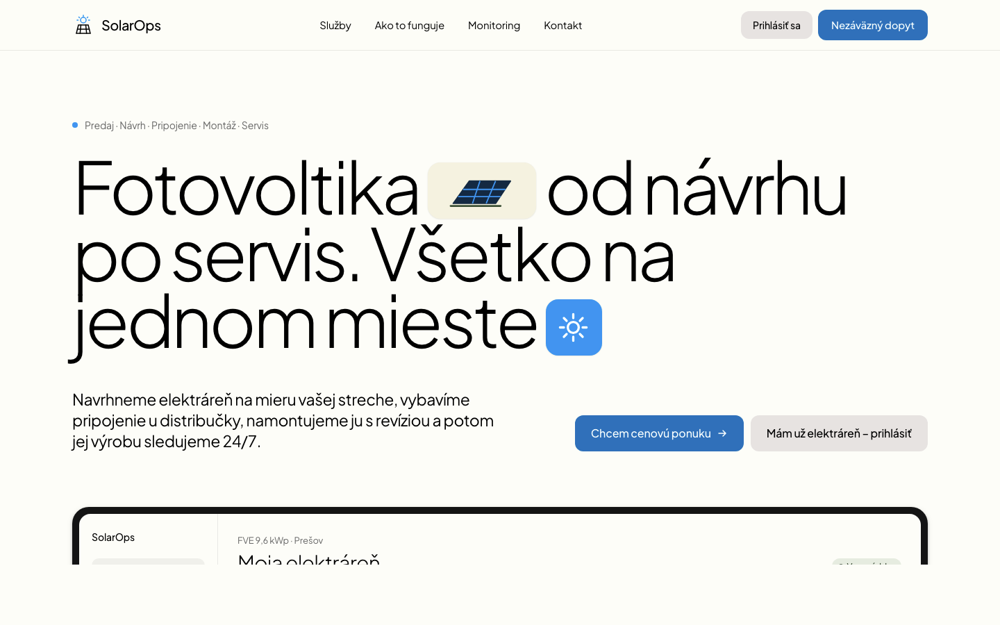
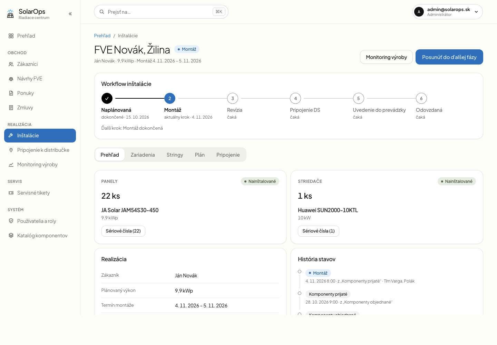
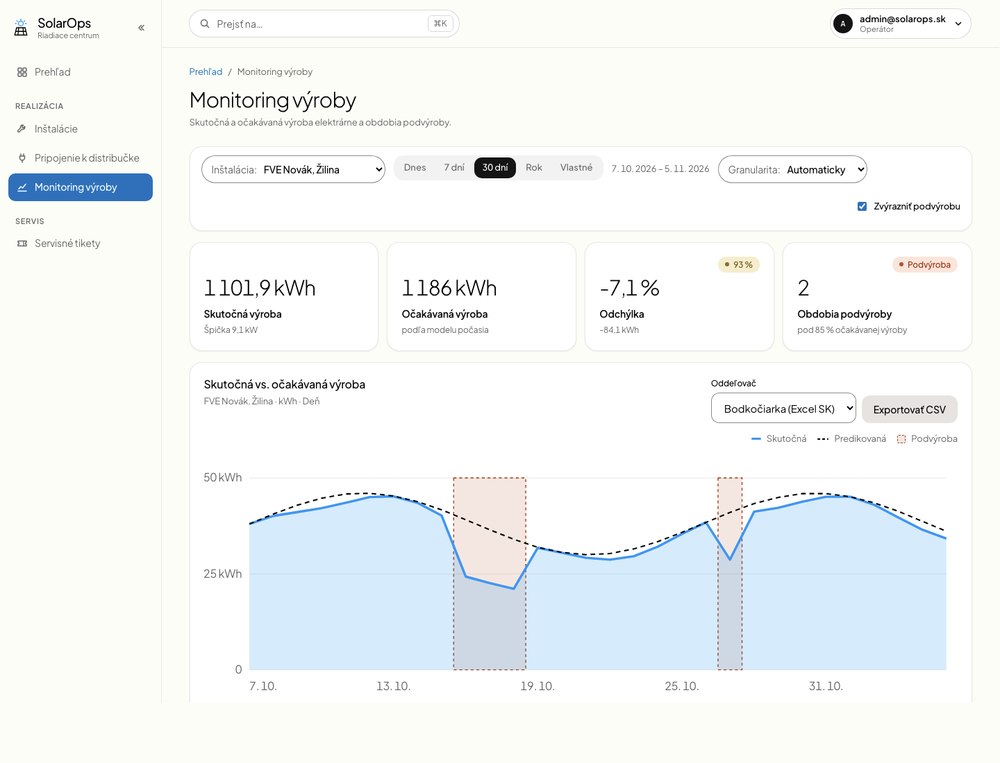
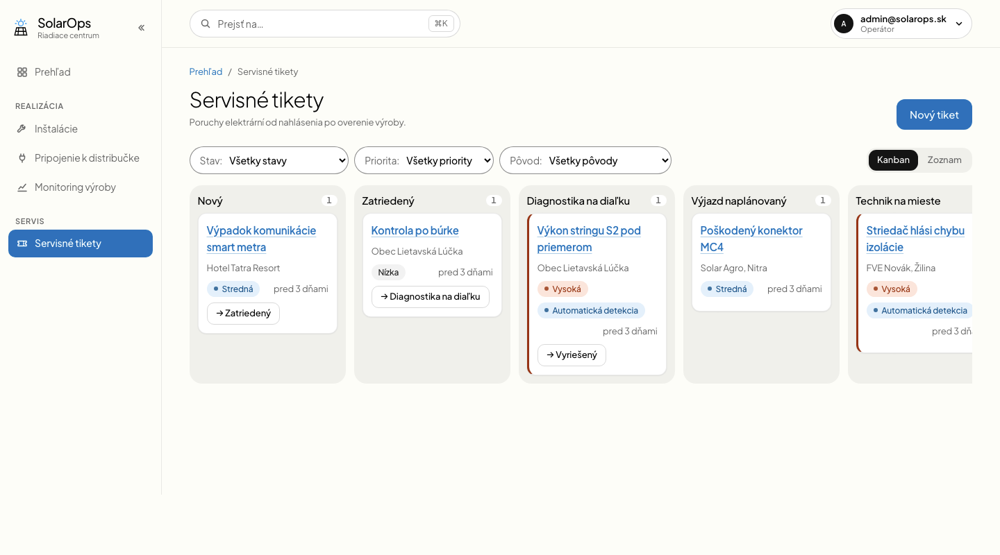
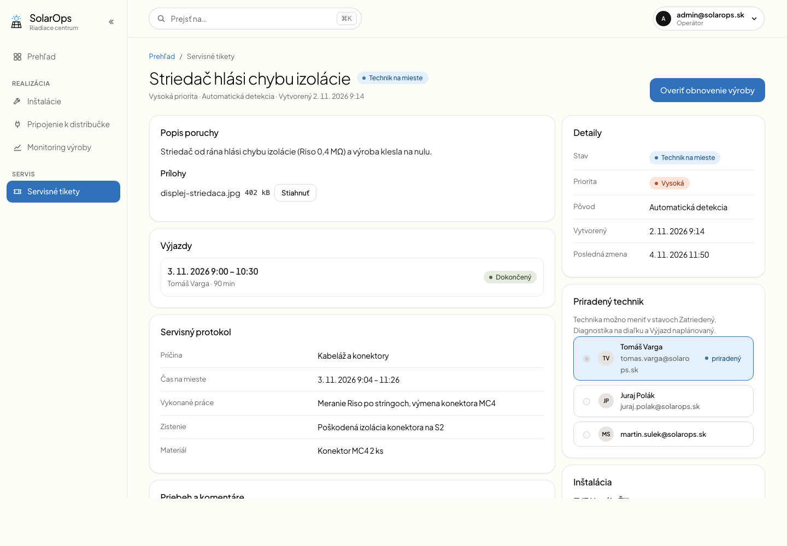
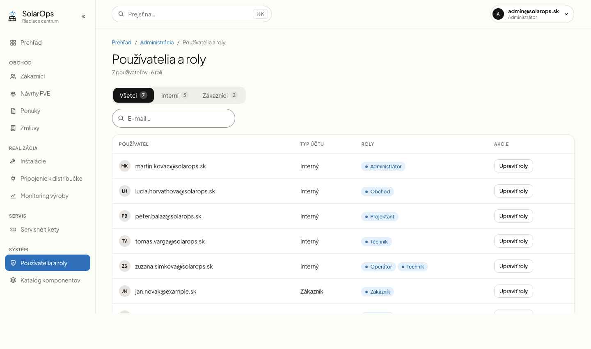
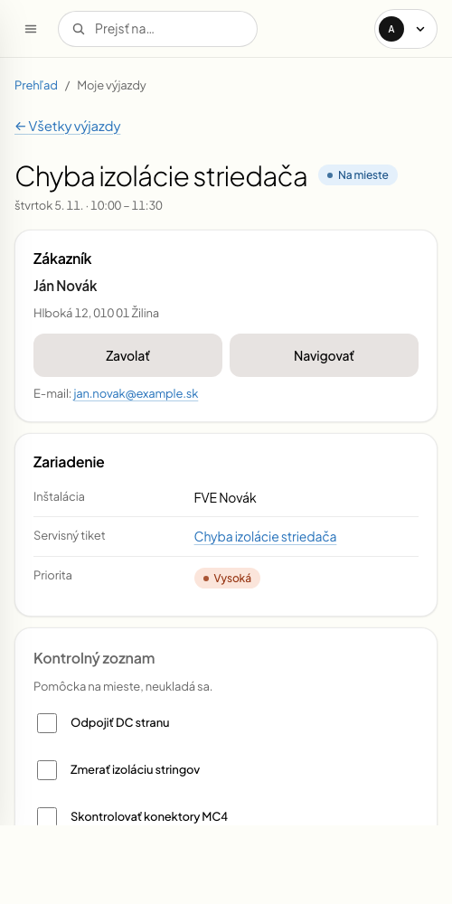

# SolarOps

Informačný systém firmy, ktorá predáva, inštaluje a servisuje fotovoltické elektrárne (FVE). Školský tímový projekt (AISPU).

Backlog: [Issues](../../issues) a [GitHub Project](https://github.com/users/takacmichal/projects/1). Architektonické rozhodnutia: [docs/adr](docs/adr/README.md).

## Stack

| Časť | Technológia | Priečinok |
|---|---|---|
| Backend | .NET 10, ASP.NET Core minimal API, EF Core 10 + Npgsql | `src/SolarOps.Api` |
| Testy backendu | xUnit, WebApplicationFactory, Testcontainers (PostgreSQL) | `tests/SolarOps.Api.Tests` |
| Frontend | **React** + Vite + TypeScript (pnpm) – od Sprintu 1 namiesto Angularu | `frontend/` |
| ML služba | Python 3.12 (uv), FastAPI, pytest, ruff | `ml/` |
| Databáza | PostgreSQL 16 | `docker-compose.yml` |
| Dokumentácia | ADR, BPMN | `docs/` |

## Snímky obrazoviek

Ukážkové dáta, dizajn podľa `docs/artefact-page-html/` (pravidlá v [`frontend/DESIGN.md`](frontend/DESIGN.md)).

| Verejná landing page | Detail inštalácie s workflow |
|---|---|
|  |  |
| **Monitoring výroby s obdobiami podvýroby** | **Servisné tikety (Kanban)** |
|  |  |
| **Detail tiketu: výjazdy, protokol, technik** | **Používatelia a roly** |
|  |  |

Mobilný pohľad technika (Moje výjazdy):



## Lokálne spustenie

Potrebné: .NET SDK 10, Node 22 + pnpm, [uv](https://docs.astral.sh/uv/), Docker.

```bash
# 1. databáza
cp .env.example .env              # voliteľné; predvolené hodnoty zodpovedajú appsettings.Development.json
docker compose up -d postgres

# 2. API (http://localhost:5080, Scalar UI: /scalar/v1, OpenAPI: /openapi/v1.json)
dotnet run --project src/SolarOps.Api
#   v Development sa schéma vytvorí automaticky aplikovaním EF migrácií
#   Migrácie nič nerobia, ak už sú aplikované: po pull-e PR s novou migráciou
#   zmaž lokálnu DB: docker compose down -v && docker compose up -d postgres

# 3. frontend (http://localhost:5173)
cd frontend
cp .env.example .env.local        # VITE_API_URL=http://localhost:5080
pnpm install
pnpm dev

# 4. ML služba (http://localhost:8000/health)
cd ml
uv python install 3.12
uv run uvicorn solarops_ml.api:app --reload --port 8000
```

Celý stack v kontajneroch: `docker compose --profile app up --build`.

Connection string pre `dotnet run` je v `src/SolarOps.Api/appsettings.Development.json` (len lokálne vývojové heslo). Ak potrebuješ iný, použi `dotnet user-secrets` alebo premennú `ConnectionStrings__Postgres`, nie commit.

JWT podpisový kľúč (`Jwt:SigningKey`, min. 32 bajtov) je v gite iba ako lokálny vývojový kľúč v `appsettings.Development.json`. Mimo Development ho nastav cez premennú `Jwt__SigningKey` (napr. `openssl rand -base64 48`), inak API nenaštartuje.

Predpoveď počasia (`Weather` sekcia) ťahá Open-Meteo Forecast API. Free tier kľúč nepotrebuje; pri platenom pláne ho nastav cez `Weather__ApiKey` (v docker compose `WEATHER_API_KEY`), nikdy ho necommituj.

ML služba sa volá na adrese `Ml:BaseUrl` (`Ml__BaseUrl`; v Development `http://localhost:8000`, v docker compose `http://ml:8000`). Prázdna hodnota znamená, že služba nie je dostupná: API normálne beží a len `POST /api/installations/{id}/analysis` vráti 503.

### Automatické servisné tikety

Každých `Ml:AnalysisIntervalMinutes` minút (predvolene 60) API analyzuje inštalácie so zapnutým monitoringom, ak je nastavené `Ml:BaseUrl` a `Ml:AnalysisEnabled` nie je `false`. Tiket vznikne v tom istom behu ako alarm. Rovnakú analýzu spustí aj tlačidlo „Spustiť analýzu“ v monitoringu.

- **Kedy:** len z prebiehajúceho alarmu; alarm, ktorý už skončil, tiket nezakladá. Tiket má pôvod `AnomalyDetected`, odchýlku a dôkazy po hodinách.
- **Bez duplicít:** ak má inštalácia otvorený tiket (nie `Resolved` ani `Closed`), nový nevznikne a alarm sa na ňom zapíše ako interný komentár. Prednosť má tiket z detekcie. Jeden alarm patrí jednému tiketu, opakovaný beh nič nepridáva.
- **Priorita:** základ určuje závažnosť z detekcie (ADR #194). Odhadovaná strata ju môže zvýšiť: od `Ml:TicketMediumLostKwh` (10 kWh) aspoň Medium, od `Ml:TicketHighLostKwh` (50 kWh) High. Keď alarmu priorita neskôr stúpne, zvýši sa aj na jeho otvorenom tikete a pribudne interný komentár. Priorita znížená operátorom ostane, kým alarmu znova nestúpne.

## Časté chyby

| Príznak | Príčina a riešenie |
|---|---|
| `dotnet test` padá hneď pri štarte integračných testov | Testcontainers potrebuje bežiaci Docker. Spusti Docker Desktop a over `docker info`. |
| API nenaštartuje mimo Development a hlási chýbajúci JWT kľúč | Nastav `Jwt__SigningKey` (min. 32 bajtov, napr. `openssl rand -base64 48`). Vývojový kľúč je len v `appsettings.Development.json`. |
| API alebo testy hlásia chýbajúcu tabuľku či stĺpec po pull-e | Pribudla migrácia. Lokálnu DB zmaž: `docker compose down -v && docker compose up -d postgres`. |
| `POST /api/auth/login` vráti 429 | Prihlásenie, registrácia a obnova hesla majú spolu limit 10 za minútu na IP. Počkaj `Retry-After` sekúnd; limit sa mení cez `RateLimiting__Auth__PermitLimit` a `RateLimiting__Auth__WindowSeconds`. Obnova tokenu má vlastný limit 60 za minútu (`RateLimiting__Refresh__*`). |
| Za reverznou proxy všetci klienti zdieľajú jeden limit | API číta `X-Forwarded-For` len od dôveryhodnej proxy. Nastav jej adresu `ForwardedHeaders__KnownProxies__0=10.0.0.5` alebo rozsah `ForwardedHeaders__KnownNetworks__0=10.0.0.0/8` podľa siete prostredia. |
| `pnpm api:fetch` zlyhá s chybou spojenia | API musí bežať na `http://localhost:5080`, alebo nastav `OPENAPI_URL`. |
| `uv run pytest` v `ml/` padá na `lightgbm` / `libomp.dylib` (macOS) | Nainštaloval sa voliteľný balík zo skupiny `experiment` (`uv run --group experiment ...`), ktorý potrebuje `brew install libomp`. Obnov prostredie príkazom `uv sync`; testy s lightgbm sa potom preskočia. |

## Dokumentácia API (OpenAPI a Scalar)

V Development sú špecifikácia (`/openapi/v1.json`) a Scalar UI (`/scalar/v1`) zapnuté vždy. Mimo Development sú predvolene vypnuté (404). Zapneš ich cez `OpenApi__Enabled=true` (napr. v Azure Container Apps). Rozhodnutie: po zapnutí sú **anonymné**, lebo špecifikácia neobsahuje tajomstvá, frontend (`pnpm api:fetch`) ju sťahuje bez tokenu a Scalar UI v prehliadači nevie poslať bearer token. Ak ju nechceš verejne, nechaj ju vypnutú.

## CORS a validácia vstupov

Prehliadač môže volať API len z originov uvedených v `Cors:AllowedOrigins`. `appsettings.json` má prázdny zoznam, `appsettings.Development.json` povoľuje `http://localhost:5173`. V Azure ho nastav cez environment, napr. `Cors__AllowedOrigins__0=https://<swa>.azurestaticapps.net` a `Cors__AllowedOrigins__1=https://app.example.com`.

Hodnota musí byť presné `scheme://host[:port]` bez cesty. API odmietne `*` aj neplatný origin už pri štarte, aby sa preklep neprejavil až v prehliadači.

DTO sa validujú DataAnnotations cez `WithValidation<T>()` (vrátane `IValidatableObject`). Validačné chyby vracajú `400 application/problem+json` s poľom `errors`; chyby bindingu (prázdne alebo nevalidné JSON telo, zlý typ v query) majú rovnaký typ odpovede s `traceId`. Rovnaký formát majú aj 404/409/429 z `ApiExceptionHandler` a rate limitu.

## Frontend: generovaný API klient

Typy API sa generujú z OpenAPI (`frontend/openapi/openapi.json`) do `frontend/src/api/generated/` (negeneruj ručne, needituj). Typovaný klient je `api` v `frontend/src/api/client.ts`.

```bash
# po zmene API: spusti API, stiahni špecifikáciu a vygeneruj typy, oboje commitni
cd frontend
pnpm api:fetch      # OPENAPI_URL prepíše predvolené http://localhost:5080/openapi/v1.json
pnpm api:generate
```

`pnpm build` (aj CI) zlyhá, ak sa vygenerované typy nezhodujú so špecifikáciou (`pnpm api:check`), a `tsc` zlyhá, ak kód používa zmenený kontrakt.

## Testy

```bash
dotnet build                      # src/ musí byť bez warningov (TreatWarningsAsErrors)
dotnet test                       # integračné testy si spustia PostgreSQL cez Testcontainers (beží Docker)
cd frontend && pnpm lint && pnpm build && pnpm test
cd ml && uv run ruff check . && uv run pytest
```

CI (`.github/workflows/backend.yml`, `frontend.yml`, `ml.yml`) sa spúšťa podľa zmenených ciest na každom PR (aj na stacked PR) a na push do `main`.

### Integračné testy API s databázou

- `PostgresFixture` spustí počas testovacieho behu jeden PostgreSQL kontajner cez Testcontainers (vyžaduje Docker).
- Každá `ApiFactory` dostane vlastnú databázu `test_<guid>` a schému vytvorenú aplikovaním EF migrácií, takže testy sa navzájom neovplyvňujú.
- `TestAuthHandler` nahrádza JWT: `CreateApiClient(userId, Roles.Sales)` simuluje prihláseného používateľa, `CreateApiClient()` je anonymný.
- CRUD scenáre sú v `Integration/<Modul>/`; `AuthorizationEndpointsTests` overuje, že každý endpoint má politiku a že anonymný volajúci dostane 401 a rola mimo matice 403.
- Integračné testy bežia v CI workflow `backend.yml` na Docker runneri.

### Pokrytie kódu

Pokrytie meria `coverlet.collector` počas `dotnet test` a [ReportGenerator](https://github.com/danielpalme/ReportGenerator) z neho vytvorí čitateľný report.

- **CI report:** workflow [`backend.yml`](https://github.com/takacmichal/AISPU/actions/workflows/backend.yml) publikuje artefakt **`backend-coverage-report`** (HTML + Cobertura + Markdown) a súhrn pokrytia pridá aj do prehľadu behu (GitHub Step Summary).
- **Prah pokrytia:** CI vyžaduje minimálne **90 % pokrytie riadkov** a **80 % pokrytie vetiev** pre assembly `SolarOps.Api` (`--minimumCoverageThresholds` v `backend.yml`). Ak ho testy nedosiahnu, ReportGenerator vráti nenulový exit kód a job `build-test` zlyhá.
- Z merania sú vylúčené testovacie projekty a kompilátorom generované súbory v `obj/` (`assemblyfilters`, `filefilters` v `.netconfig`).

Lokálne:

```bash
dotnet tool restore                  # nainštaluje ReportGenerator z .config/dotnet-tools.json
dotnet test --collect "XPlat Code Coverage"
dotnet reportgenerator \
  "--minimumCoverageThresholds:lineCoverage=90" \
  "--minimumCoverageThresholds:branchCoverage=80"
open coverage-report/index.html      # macOS; na Linuxe xdg-open
```

Konfigurácia reportu (vstupné súbory, výstupný priečinok, typy reportov, filtre) je v `.netconfig`; dopĺňajú sa už len prahy pokrytia, ktoré ReportGenerator 5.5.x z `.netconfig` nečíta.

## Backend: modulový vzor (pre feature PR)

API je jeden projekt rozdelený na vertikálne moduly v `src/SolarOps.Api/Features/<Modul>/`. **Feature PR nemení `Program.cs`, `AppDbContext` ani CI.** Vzorový modul: `Features/System/SystemModule.cs`.

1. Vytvor triedu implementujúcu `IModule` (verejný bezparametrický konštruktor). Pri štarte ju nájde reflexia:

   ```csharp
   public sealed class ProjectsModule : IModule
   {
       public void AddServices(IServiceCollection services, IConfiguration configuration)
       {
           services.AddScoped<IProjectService, ProjectService>();
       }

       public void MapEndpoints(IEndpointRouteBuilder endpoints)
       {
           var group = endpoints.MapGroup("/api/projects").WithTags("Projects");
           group.MapPost("/", CreateAsync).WithValidation<CreateProjectRequest>();
       }
   }
   ```

2. Entity a ich EF konfigurácia (`IEntityTypeConfiguration<T>`) patria do modulu. `AppDbContext` ich načíta cez `ApplyConfigurationsFromAssembly`; k dátam pristupuj cez `db.Set<T>()`. Tabuľky a stĺpce sú automaticky `snake_case`, kľúče `Guid` (`Guid.CreateVersion7()`), čas `DateTimeOffset` v UTC (`TimeProvider` je v DI).
3. Chyby: `DomainException` → 409, `NotFoundException` → 404, `RequestValidationException` → 400, `UnauthorizedAccessException` → 401, všetko ako ProblemDetails. Vstupné DTO validuj cez DataAnnotations a `.WithValidation<T>()`.
4. Aktuálny používateľ: `ICurrentUser` (`UserId`, `Roles`, `IsInRole`, `RequireUserId()`); dotazy na dáta používateľa vždy filtruj podľa neho. Názvy rolí sú v `Infrastructure/Identity/Roles`. Autentifikáciu (Identity + JWT Bearer, `/api/auth/*`) zabezpečuje modul `Features/Auth` (#132); v autorizačných politikách nenastavuj natvrdo schému, aby testy mohli použiť testovaciu.
5. Enumy sa serializujú ako reťazce. Stavové prechody sú metódy na entite, ktoré pri neplatnom prechode hodia `DomainException`.
6. Nový NuGet balík: verzia patrí do `Directory.Packages.props` (balíky Sprintu 1 sú tam už pripravené), do `.csproj` modulu pridaj len `<PackageReference Include="..." />` bez verzie.
7. Integračné testy: `IClassFixture<PostgresFixture>` (bez `[Collection]`, aby triedy bežali paralelne), konštruktor s `PostgresFixture`, `new ApiFactory(postgres)` (každá factory má vlastnú databázu, kópiu migrovanej template), `factory.CreateApiClient()` (anonymný) alebo `factory.CreateApiClient(userId, Roles.Sales)` (prihlásený cez testovaciu schému `TestAuthHandler`, funguje aj po pridaní JWT v #132), seed cez `factory.ExecuteDbAsync(db => ...)`. Unit testy patria do `tests/SolarOps.Api.Tests/Unit/<Modul>/`, integračné do `Integration/<Modul>/`.

**EF migrácie sú súčasťou zmeny schémy.** Dev aj testy aplikujú migrácie (`MigrateAsync`); pri pridaní alebo zmene entity vygeneruj migráciu (`dotnet ef migrations add <Nazov> --project src/SolarOps.Api --startup-project src/SolarOps.Api`) a commitni ju spolu s kódom. `EnsureCreated` sa už nepoužíva.

## Nasadenie do Azure

Infraštruktúra je v Bicep v [`infra/`](infra/README.md): Container Apps (API, ML služba, frontend a joby), PostgreSQL Flexible Server, Key Vault a Log Analytics v regióne Poland Central. Nasadenie je `infra/deploy.sh`; tajomstvá generuje do ignorovaného `infra/.env`.

## Pravidlá PR a merge

- 1 issue = 1 PR, najprv ako **draft**. Vetva `sprint1/<NN>-<issue>-<slug>`, commit správy po anglicky v rozkazovacom spôsobe.
- **Stacked PR:** foundation PR (`sprint1/00-foundation`) sa merguje **prvý**, všetky stacky Sprintu 1 sú postavené na ňom. Každý PR v stacku má base = predchádzajúca vetva.
- Mergovať **merge commitom (nie squash)**, zdola nahor. Ak sa predsa použije squash, ďalší PR v stacku treba prebázovať: `git rebase --onto main <stará-base>`.
- Pred pushom musí na vetve prejsť `dotnet build` + `dotnet test` (resp. `pnpm build`, `uv run pytest`).
- Žiadne tajomstvá v gite: lokálne `dotnet user-secrets` / `.env` (ignorovaný), v gite len `.env.example`.
