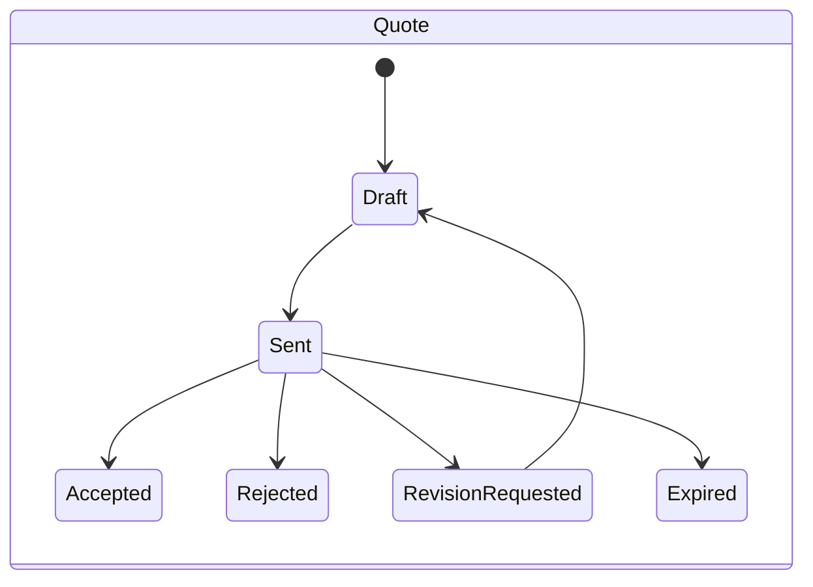
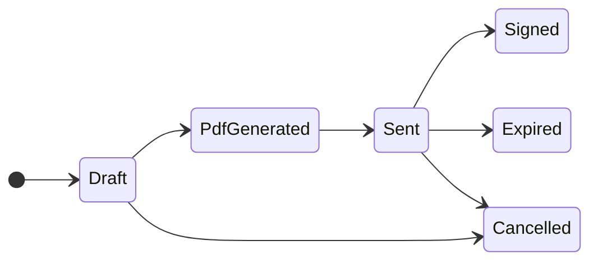
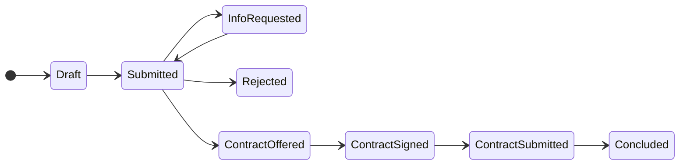
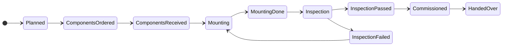
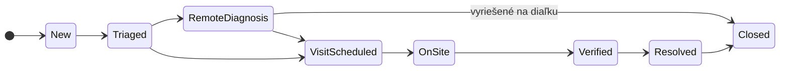

# ADR spike #207: Roly (BPMN lanes na roly aplikácie) a workflow (stavy v kóde vs. engine)

- **Stav:** Navrhnuté
- **Dátum:** 2026-10-15
- **Issue:** #207 (nadradené #9)
- **Súvisí:** #218 (autentifikácia), mapovanie entít a stavov `docs/bpmn` (PR #282, `bpmn-mapovanie.md`)

## Kontext

BPMN modely (Sprint 0) majú lanes Obchod, Projektant, Technik a externé pooly Zákazník, Distribučka, ML. Procesy majú stavy (ponuka, zmluva, žiadosť o pripojenie, inštalácia, tiket). Treba určiť roly aplikácie, ich oprávnenia a či stavy riadiť enumami v kóde, alebo workflow enginom. Tím má 3 ľudí a cca 3 mesiace; backend je jeden .NET 10 projekt s vertical slices.

## Zvažované možnosti

| Kritérium | A. Stavové enumy v entitách (prechody ako metódy) | B. Elsa Workflows 3 | C. Workflow Core | D. Camunda 8 (Zeebe) |
|---|---|---|---|---|
| Licencia | n/a | MIT [1] | MIT [2] | Camunda License 1.0 (zdrojovo dostupná, nie OSI) okrem častí pod Apache 2.0 [3]; podmienky produkčného použitia **neoverené** |
| Údržba (k 15. 10. 2026) | n/a | aktívna, posledné vydanie 3.9.0 (4. 10. 2026) [1] | aktívna, posledné vydanie 3.21.0 (7. 9. 2026) [2] | aktívna, posledné vydanie 8.10.4 (13. 10. 2026) [3] |
| Dodatočná infraštruktúra | žiadna | knižnica + vlastné tabuľky workflow (persistencia) | knižnica + persistencia | samostatný Zeebe cluster (Java), klient cez gRPC; ďalší kontajner v Azure |
| Zhoda s BPMN | manuálna (diagram = dokumentácia) | vlastný model (nie BPMN 2.0) | vlastný model (nie BPMN) | natívne BPMN 2.0 |
| Ľudské úlohy a lehoty | vlastné (background job na expiráciu) | podporované | podporované | podporované |
| Testovateľnosť | jednoduché unit testy prechodov | vyžaduje runtime v testoch | vyžaduje runtime v testoch | vyžaduje cluster |
| Krivka učenia a riziko pre 3 ľudí | nízke | stredné | stredné | vysoké |
| Pridaná hodnota pre rozsah projektu | dostatočná (lineárne procesy so 5 až 10 stavmi) | nízka | nízka | nízka (rozsah neobsahuje dlhobežiace orchestrácie medzi systémami) |

## Rozhodnutie

**Možnosť A: workflow = stavové enumy v entitách, žiadny workflow engine.** Roly aplikácie: `Admin`, `Sales`, `Designer`, `Technician`, `Operator`, `Customer`.

### Mapovanie BPMN lanes na roly

| BPMN lane / strana | Rola aplikácie | Poznámka |
|---|---|---|
| Obchod | `Sales` | zákazníci, ponuky, zmluvy, plánovanie inštalácie |
| Projektant | `Designer` | návrh FVE, žiadosť o pripojenie k distribučke |
| Technik | `Technician` | inštalácia, revízia, výjazdy, servisný protokol |
| Operátor (back office, v tabuľkách #61 až #68 označený "O" spolu s Obchodom) | `Operator` | triedenie tiketov, preverenie alertov, monitoring, notifikácie |
| Zákazník (pool) | `Customer` | iba vlastné dáta (#137) |
| Distribučka, ML služba (pooly) | bez roly | simulované cez endpointy / servisný účet ML služby (návrh) |
| (nie je lane) | `Admin` | správa používateľov a rolí, plný prístup |

### Matica rola × oprávnenia (návrh; R = čítať, W = vytvárať/upravovať, T = vykonávať prechody stavov, own = len vlastné záznamy)

| Modul | Admin | Sales | Designer | Technician | Operator | Customer |
|---|---|---|---|---|---|---|
| Používatelia a roly | RWT | | | | | vlastný profil |
| Zákazníci, odberné miesta | RWT | RWT | R | R | R | R own |
| Katalóg komponentov | RWT | RW | R | R | R | |
| Ponuky (`Quote`) | RWT | RWT | R | | R | R own, T own (accept/reject/request-revision) |
| Návrh FVE (`FveDesign`) | RWT | R, T (approve/rework) | RWT | R | | R own |
| Zmluvy a záloha (`Contract`) | RWT | RWT | R | | R | R own, T own (sign) |
| Žiadosť o pripojenie (`ConnectionRequest`) | RWT | R, T (resubmit, send-contract, customer-signed) | RWT | R | R | R own |
| Inštalácie, komponenty (`Installation`, `Component`) | RWT | RW, T (plan, order) | R | RW, T (receive, mounting, inspection, commission) | R | R own |
| Servisné tikety a výjazdy (`ServiceTicket`, `ServiceVisit`) | RWT | R | R | RW, T (visit, report, verify) | RWT | R own, W (nahlásenie poruchy) |
| Alerty, telemetria (`Alert`) | RWT | R | R | R | RWT | R own |
| Notifikácie | RWT | R | R | R | RWT | R own |

Autorizácia sa implementuje politikami (`RequireRole`) na endpointoch (#136) a filtrom "vlastné dáta" pre `Customer` (#137). Matica je návrh a pri implementácii sa môže spresniť; zmeny sa zapisujú sem.

### Jednotný model stavov a auditu

- Každá stavová entita má **enum** (názvy v angličtine podľa `bpmn-mapovanie.md`) a **metódy prechodov** (`Send()`, `Accept()`, ...), ktoré pri neplatnom prechode vyhodia doménovú výnimku (HTTP 409 ProblemDetails).
- **Audit prechodov:** jedna tabuľka `state_transitions` (návrh): `id` (Guid v7), `entity_type`, `entity_id`, `from_state`, `to_state`, `actor_user_id` (null pre systém/job), `occurred_at` (UTC), `note`. Zápis robí spoločný pomocný kód pri prechode v tej istej transakcii ako zmena entity. Neplatné pokusy sa nezapisujú.
- **Časové prechody** (expirácia zmluvy, ponuky, `Overdue` zálohy, lehoty distribučky) rieši plánovaná úloha (hosted service), ktorá volá tie isté metódy s `actor = null`.

### Diagramy stavov kľúčových entít

(`FveDesign`, `DepositPayment`, `Alert`, `ServiceVisit` a ďalšie sú v `bpmn-mapovanie.md`; model je rovnaký.)

## Dôsledky

- (+) Žiadna závislosť navyše, prechody sú obyčajné unit-testovateľné metódy (#170), diagramy v dokumentácii sú zdrojom pravdy pre testy.
- (+) Stavy a prechody žijú pri entite (vertical slices), moduly sa neprepájajú cez engine.
- (-) Zmena procesu = zmena kódu a nasadenie (nie úprava modelu za behu).
- (-) Plánované prechody a lehoty treba pokryť vlastným jobom a testmi.
- Implementácia **musí** dodržať: šesť rolí s uvedenými názvami, stavy ako enumy v entitách, žiadny engine, neplatný prechod = doménová výnimka (409).

## Riziká a neoverené

- Matica oprávnení je návrh, nebola odsúhlasená s vlastníkom produktu (**neoverené**).
- Podmienky Camunda License 1.0 pre produkčné použitie a rozsah funkcií bez platenej licencie som nečítal (**neoverené**); rozhodnutie na ne nie je závislé.
- Pri veľkom náraste procesov (viac organizácií, dlhobežiace orchestrácie) môže byť engine potrebný; vtedy by sa audit tabuľka a názvy stavov preniesli.

## Zdroje

1. Elsa Workflows (MIT, 3.9.0): https://github.com/elsa-workflows/elsa-core
2. Workflow Core (MIT, 3.21.0): https://github.com/danielgerlag/workflow-core
3. Camunda 8 (Camunda License 1.0 + Apache 2.0 časti, 8.10.4): https://github.com/camunda/camunda
4. Mapovanie BPMN na entity a stavy: `docs/bpmn` (PR #282)

## Nadväzujúce issues

- #135 Definovať roly a pridelenie rolí, #136 Chrániť endpointy podľa rolí, #137 Obmedziť zákazníka len na vlastné dáta (feature #40).
- #170 Unit testy doménovej logiky (testy prechodov stavov).
- Stories entít so stavmi: #74/#75 (ponuky), #79/#81 (zmluvy), #85/#86 (žiadosť o pripojenie), #82 (inštalácia).
