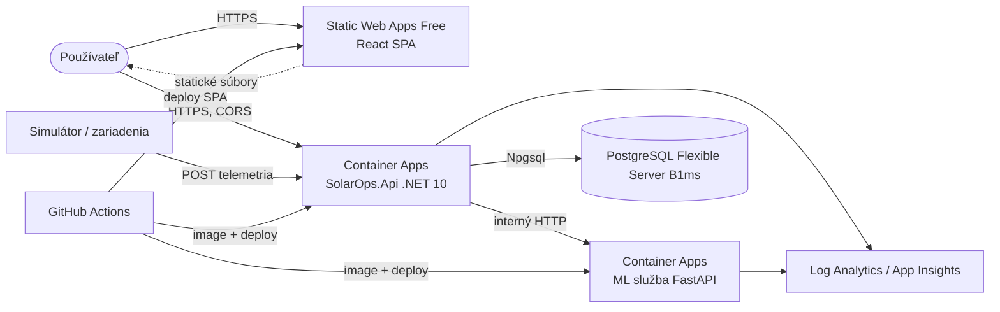

# ADR spike #211: Azure hosting (App Service vs. Container Apps, Static Web Apps)

- **Stav:** Navrhnuté
- **Dátum:** 2026-10-15
- **Issue:** #211 (nadradené #11); duplicity zo Sprintu 0: #210, #214 (pokryté týmto ADR)
- **Súvisí:** #215 (náklady), #196 (REST ML služba), #218 (cross-site auth), #213 (PostgreSQL)

## Kontext

Treba hostovať tri časti: **.NET 10 API**, **Python FastAPI ML službu** (kontajner, #196) a **React + Vite SPA** (v checklist issue je ešte Angular; rozsah sa zmenil, hosting statických súborov je rovnaký). Databáza je PostgreSQL. Rozpočet je študentský kredit (#215), prevádzka je demo/hodnotenie, nie 24/7 produkcia, takže záleží na scale-to-zero a cene. Deploy cez GitHub Actions (Sprint 4, #157 až #169, #277 až #280).

## Zvažované možnosti

| Kritérium | A. Azure Container Apps (Consumption) pre API + ML, Static Web Apps pre SPA | B. App Service (Linux) pre API a ML, SWA pre SPA | C. Všetko na App Service / VM |
|---|---|---|---|
| Kontajnery a ML služba | natívne kontajnery, viac aplikácií v jednom prostredí | kontajnery podporované, ale plán sa platí za vyhradenú inštanciu | ručná správa |
| Scale-to-zero | áno, predvolené minimum replík je 0 [1] | nie (platí sa za plán, aj keď je nečinný) | nie |
| Cena pri nízkej prevádzke | platí sa za sekundy využitia; mesačný free grant 180 000 vCPU-s, 360 000 GiB-s, 2 mil. požiadaviek na subscription [1][2] | cena plánu (napr. B1 podľa Retail Prices API 0,075 USD/h, OS plánu **neoverený**) | vyššia |
| Cold start | pri scale-to-zero prvý request čaká na štart repliky (dĺžka **neoverená**, nemeraná) | bez cold startu pri Always On | nie |
| CI/CD | GitHub Actions + image do registra | GitHub Actions (kód alebo image) | ručné |
| Komplexnosť | stredná (prostredie, registry, secrets) | nižšia pre jedinú aplikáciu | vysoká |

Static Web Apps (SPA) – overené: plán **Free** je určený pre osobné projekty, max. veľkosť aplikácie 250 MB, 2 vlastné domény, 3 staging prostredia, API iba cez *managed* Azure Functions [3]. **Prepojenie (linked backend) na Container Apps vyžaduje plán Standard** [4] (cena 9 USD/mesiac podľa Retail Prices API). Na plane Free preto SPA volá API **priamo**.

## Rozhodnutie

- **API a ML služba: Azure Container Apps** (Consumption), dve aplikácie v jednom prostredí. API s `minReplicas = 0` (prípadne 1 pred obhajobou), ML služba s `minReplicas = 0`; ML je volané iba z API (interný ingress), API má verejný ingress.
- **Frontend (React): Azure Static Web Apps**, plán Free.
- **Databáza: Azure Database for PostgreSQL Flexible Server, B1ms** (ADR #213, cena v #215).
- Registry obrazov: GitHub Container Registry alebo Azure Container Registry Basic (**navrhované**, nerozhodnuté tu; ACR Basic je podľa Retail Prices API 0,1666 USD/deň).

### Cieľová architektúra

### Dôsledky pre frontend (SWA Free)

- **Žiadne proxy**: SPA volá API na jeho verejnej adrese (`VITE_API_URL`), preto API musí povoliť **CORS** pre doménu SWA (#279). Auth cookies by boli cross-site (pozri ADR #218), preto sa používa bearer token.
- **SPA routing**: `staticwebapp.config.json` s `navigationFallback` na `/index.html` a bezpečnostnými hlavičkami (#278).
- Pull-request prostredia SWA nepodporujú linked backend [4]; pre ne platí tá istá priama adresa API.

## Dôsledky

- (+) Pri nízkej prevádzke sa blížime k nulovým nákladom na výpočet, ML služba sa nespúšťa, keď nie je potrebná.
- (+) Kontajnerový model je rovnaký lokálne (docker-compose) aj v Azure.
- (-) Cold start prvého požiadavku po nečinnosti (pred obhajobou nastaviť `minReplicas = 1` pre API).
- (-) Priame volanie API z prehliadača vyžaduje správne CORS a verejné API; prechod na Standard (linked backend) by dal jednu doménu, ale stojí 9 USD/mesiac a v tomto ADR sa nepoužíva.
- Implementácia **musí** použiť: Container Apps (API + ML), Static Web Apps (React), PostgreSQL Flexible Server B1ms.

## Riziká a neoverené

- Dĺžka cold startu API a ML (nemerané), vplyv na demo a časové limity (#196: timeout 15 s).
- Limity Azure for Students (dostupné regióny, kvóty na Container Apps v subscription) – **neoverené** (#215).
- Cena App Service B1 závisí od OS plánu; porovnanie je orientačné.
- Spoločné prostredie Container Apps vytvára Log Analytics workspace (náklady v #215).

## Zdroje

1. Container Apps: škálovanie (predvolené minimum replík 0): https://learn.microsoft.com/en-us/azure/container-apps/scale-app
2. Container Apps: fakturácia a mesačné bezplatné množstvá: https://learn.microsoft.com/en-us/azure/container-apps/billing
3. Static Web Apps: plány (Free vs. Standard): https://learn.microsoft.com/en-us/azure/static-web-apps/plans
4. Static Web Apps: prepojenie na Container Apps (vyžaduje Standard): https://learn.microsoft.com/en-us/azure/static-web-apps/apis-container-apps
5. Azure Retail Prices API (ceny): https://prices.azure.com/api/retail/prices

## Nadväzujúce issues

- Sprint 4: #157 Azure prostredie ako kód, #163/#164 ML kontajner a nasadenie, #160 až #162 CI/CD, #277 až #280 nasadenie frontendu (SWA, SPA routing, CORS, workflow), #165/#166 (Angular, doména), #167/#168 monitoring.
- Zastarané názvy (nevytvárané ani upravené v tomto PR): #158 Azure SQL (databáza je PostgreSQL), #165/#277 Angular (frontend je React).
