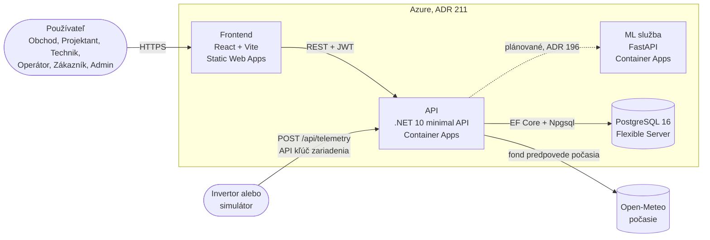
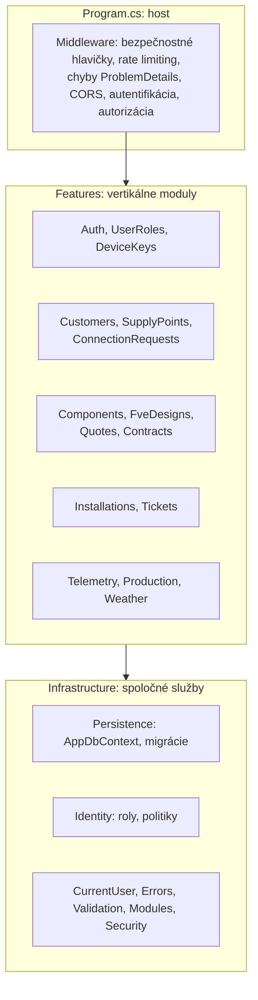

# Architektúra SolarOps

Prehľad systému pre nového člena tímu. Podrobné odôvodnenia sú v [ADR](adr/README.md), procesy v [BPMN](bpmn/), pravidlá kódu v [CLAUDE.md](../CLAUDE.md) a [README](../README.md).

Názov issue #181 hovorí o „Clean Architecture“, ale implementácia je **modulárny monolit s vertikálnymi modulmi** (ADR #209): jeden projekt API rozdelený na moduly po doménových oblastiach, nie na vrstvy Domain/Application/Infrastructure.

## Komponenty

Plná čiara je implementované, bodkovaná je plánované: **API zatiaľ ML službu nevolá** (v `src/` nie je klient ML). ML služba beží samostatne a vystavuje `POST /v1/predictions/production` (predikcia výroby), `POST /v1/detections/underproduction` (detekcia podvýroby) a `GET /health`. ML služba nemá prístup k databáze; aké dáta dostane od API, sa rieši až pri integrácii (ADR #196: REST cez typed `HttpClient`, ONNX zamietnutý).

| Časť | Technológia | Priečinok | Nasadenie |
|---|---|---|---|
| Frontend | React 19, Vite, TypeScript, pnpm, typy generované z OpenAPI | `frontend/` | Azure Static Web Apps |
| API | .NET 10, ASP.NET Core minimal API, EF Core 10 + Npgsql | `src/SolarOps.Api` | Azure Container Apps |
| ML služba a simulátor | Python 3.12, FastAPI, pandas, scikit-learn, uv | `ml/` | Azure Container Apps (interný ingress) |
| Databáza | PostgreSQL 16 | `docker-compose.yml` lokálne | Azure Database for PostgreSQL Flexible Server |

## Vrstvy backendu

API je jeden projekt. Každý modul v `Features/<Modul>/` je vertikálny rez (endpointy, služby, entity, kontrakty) a registruje sa sám cez `IModule`; `Program.cs` ho nemení (reflexia).

| Vrstva | Zodpovednosť | Kde |
|---|---|---|
| Host | skladá pipeline a konfiguráciu, nájde moduly | `Program.cs` |
| Middleware | hlavičky, limit prihlásení (429), chyby ako ProblemDetails, CORS, JWT, autorizácia | `Infrastructure/Security`, `Errors`, `Identity` |
| Moduly (Features) | doména a HTTP kontrakty jednej oblasti; stavové prechody sú metódy entít (`DomainException` = 409) | `Features/<Modul>/` |
| Infraštruktúra | `AppDbContext` a migrácie, aktuálny používateľ, validácia vstupu, politiky rolí | `Infrastructure/` |

Pravidlá, ktoré moduly dodržiavajú: dáta používateľa sa filtrujú cez `ICurrentUser` (zákazník vidí len svoje a cudzí záznam vracia 404), kľúče sú `Guid` v7, čas je UTC cez `TimeProvider`, tabuľky a stĺpce `snake_case`, každá zmena schémy má EF migráciu.

## Dátové toky

1. **Telemetria:** invertor alebo simulátor pošle dávku (kontrakt ADR #185, najviac 288 meraní po 5 minút) na `POST /api/telemetry` s API kľúčom zariadenia; API zapíše merania do PostgreSQL deduplikovane. Frontend ich číta cez modul Production (výroba, porovnanie, export).
2. **Počasie:** `WeatherForecastBackgroundService` periodicky sťahuje predpoveď z Open-Meteo (ADR #180) a ukladá ju do databázy.
3. **Obchodný proces:** ponuka, návrh FVE, zmluva, pripojenie k distribučke, inštalácia a servisné tikety sú moduly s workflow stavmi podľa BPMN (`docs/bpmn/`).
4. **ML (stav):** predikcia výroby a detekcia podvýroby sú implementované v `ml/` a testované samostatne; napojenie na API a vytváranie tiketov z alarmov ešte nie je hotové.

## Bezpečnosť

ASP.NET Core Identity s JWT access tokenom (15 min) a rotujúcim refresh tokenom (ADR #218); šesť rolí (Admin, Sales, Designer, Technician, Operator, Customer) a politiky v `AuthorizationPolicies`; zariadenia sa autentifikujú API kľúčom; login má rate limit; tajomstvá len z konfigurácie (`dotnet user-secrets`, premenné prostredia), nikdy v gite.

## Zhrnutie rozhodnutí zo spikov

| Oblasť | Rozhodnutie | ADR |
|---|---|---|
| Štruktúra repa | monorepo, CI s `paths` filtrami | #209 |
| Hosting | Container Apps (API, ML), Static Web Apps (frontend) | #211, #201 |
| Databáza | PostgreSQL + EF Core + Npgsql | #213 |
| Autentifikácia | Identity + JWT + rotujúci refresh token | #218 |
| Integrácia ML | REST (FastAPI), nie ONNX | #196 |
| Model výroby | fyzikálny baseline pre MVP, LightGBM challenger | #191 |
| Podvýroba | pravidlo `r < 0,85` aspoň 2 h; Isolation Forest zamietnutý | #194, #208 |
| Telemetria | JSON dávky po 5 min, deduplikácia | #185 |
| Obnovovanie dashboardu | polling: dáta 5 min, alarmy 60 s; SignalR/SSE až pri reálnej potrebe | #222 |
| Verzovanie modelu | `metadata.json` v Blob Storage + git tag | #198 |

## Známe medzery

- Frontend: README aj ADR #209 uvádzajú React; staré issues hovoria o Angularu a sú zastarané.
- Integrácia API a ML služby nie je hotová.
- Nasadenie: existuje workflow `frontend-deploy.yml` (Static Web Apps, vyžaduje secret a premennú v repozitári) a Bicep v `infra/` vytvára prostredie (Container Apps, PostgreSQL, Static Web Apps). Nasadenie API a ML do Container Apps, Key Vault, monitoring ani CD pre ne zatiaľ neexistujú; postup je v ADR #201, #211 a `infra/README.md`.
